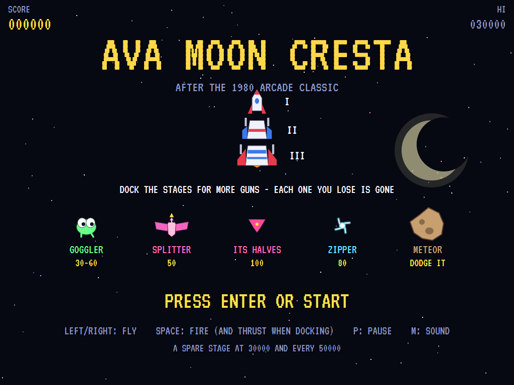
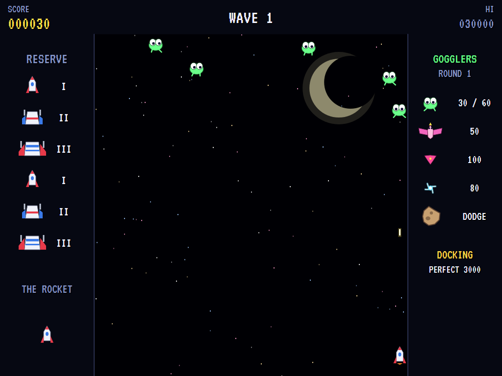
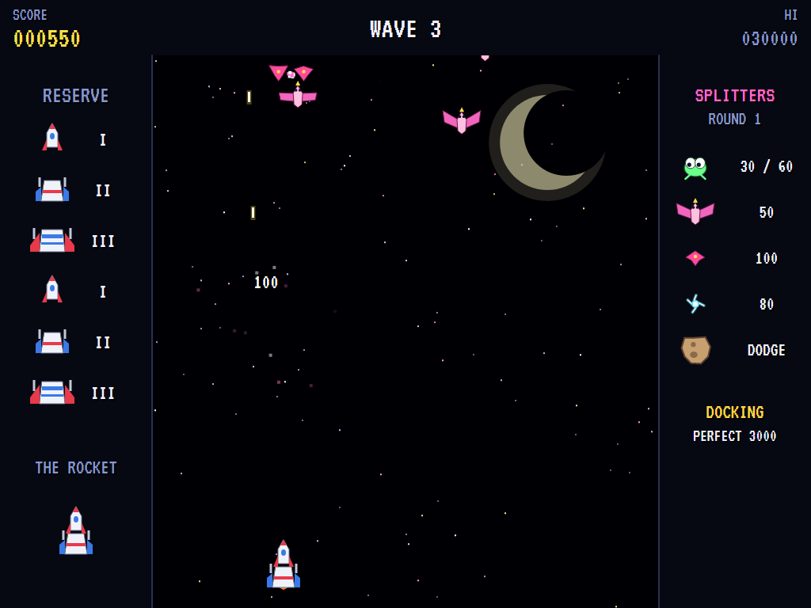
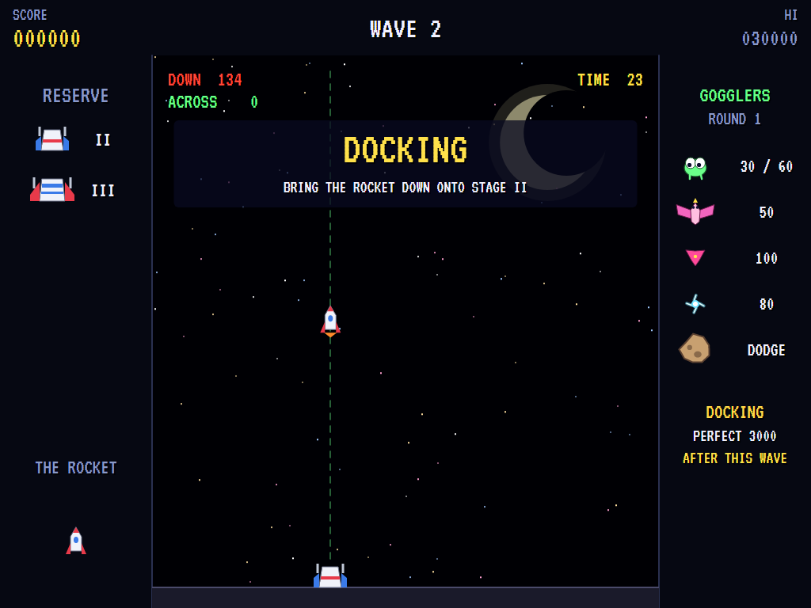
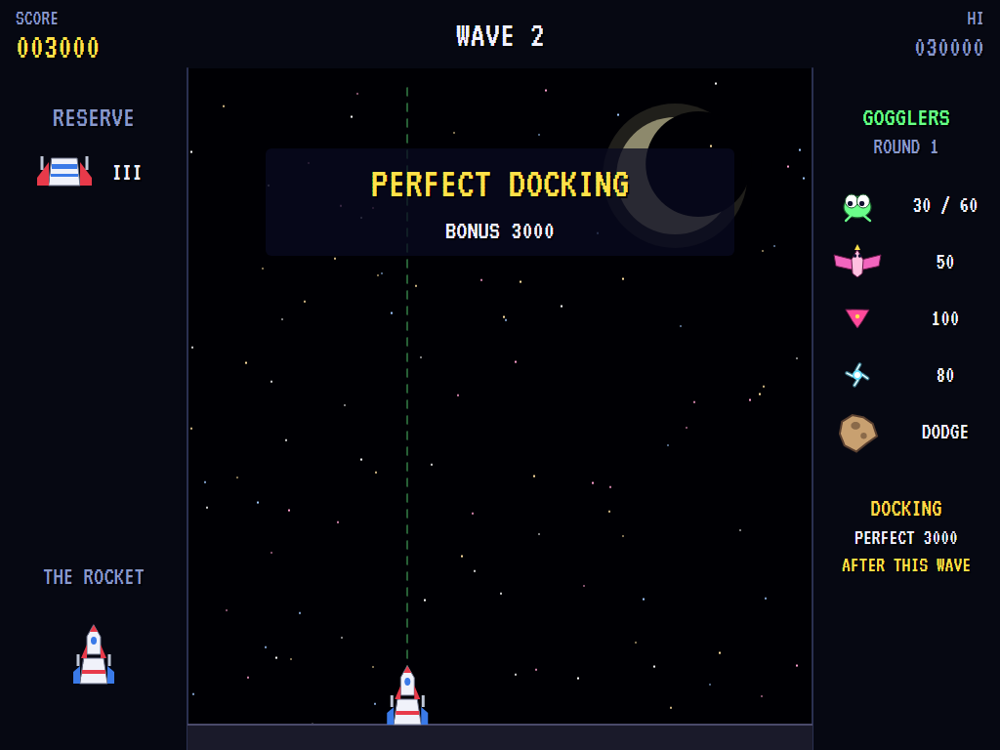
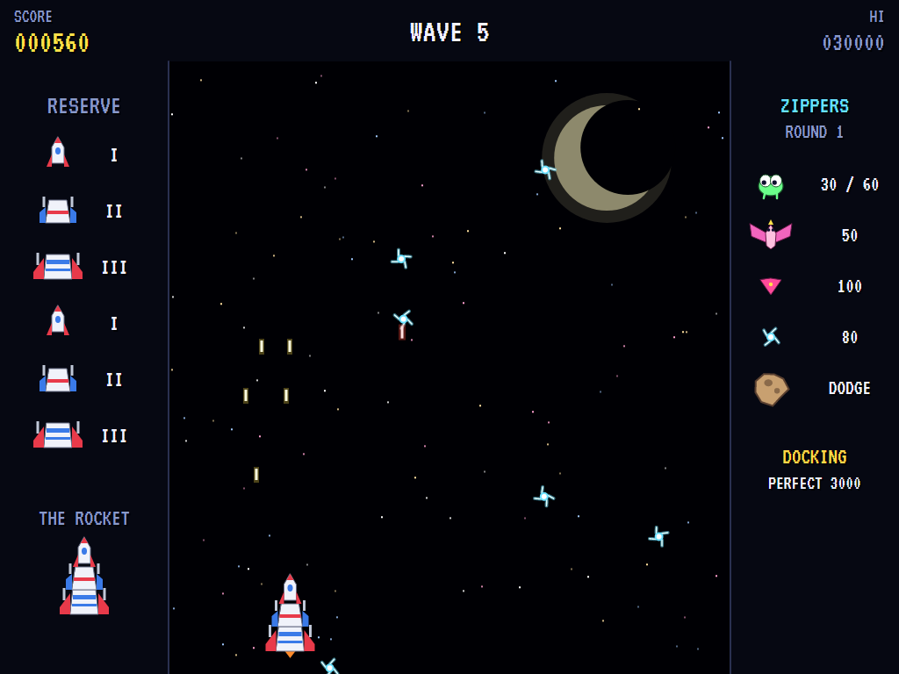
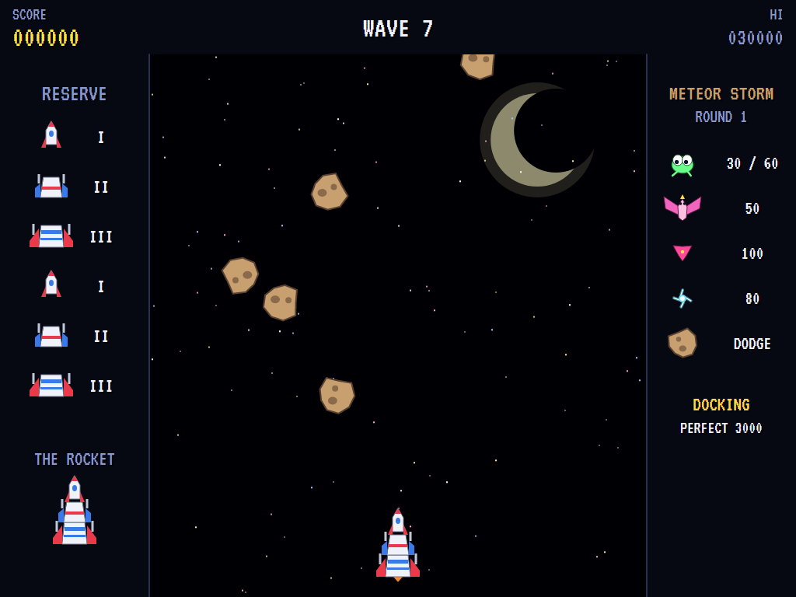
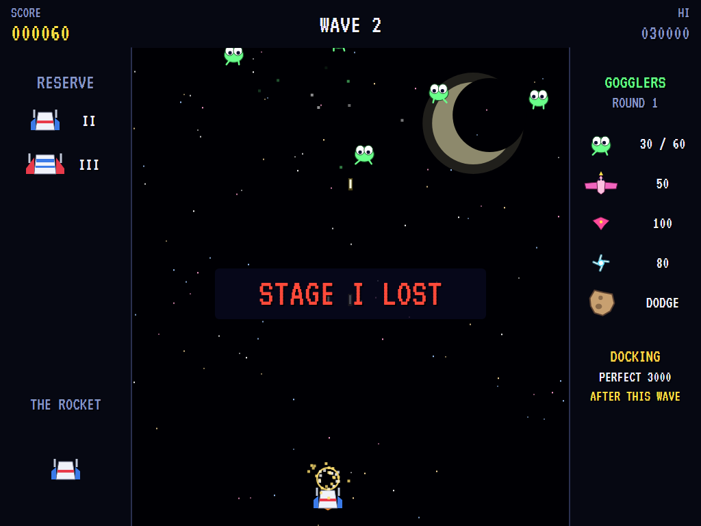
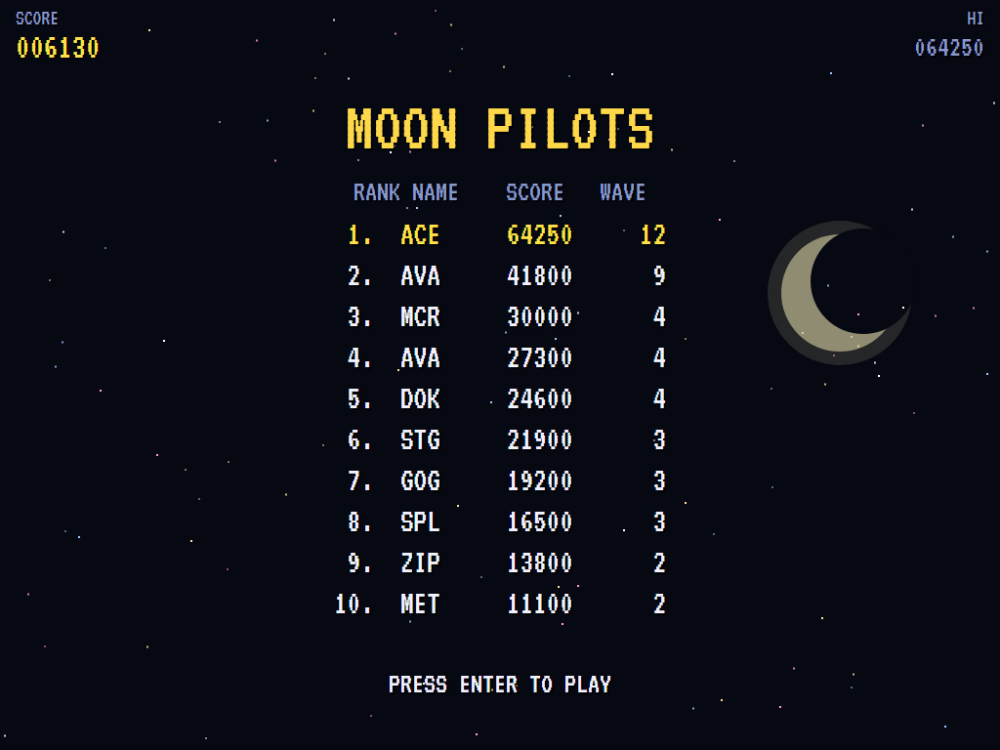

# AVA Moon Cresta

[](https://github.com/Harlock123/AVAMoonCresta/actions/workflows/build.yml)

A space shooter in the style of Nichibutsu's 1980 arcade game **Moon Cresta**, built with .NET 10 and
Avalonia UI. Your rocket is three stages, and they're your lives. You start flying the smallest, and twice
in every round you get the chance to bring it down onto the next stage and dock, for more guns. Each
stage you lose is gone for good. Wave after wave of Gogglers, Splitters and Zippers come at you, then a
meteor storm you can only dodge.

## Features

- **The rocket**:
  - **Stage I** is a slim nose with a single gun.
  - **Stage II** is a broader body with two guns.
  - **Stage III** is the widest, with two more guns spread wider and the main engine.
  - **Firing:** docked together, every stage fires its own volley, one in the air at a time each.
  - **Losing stages:** a stage that's hit is lost, and the rest fly on for a moment's safety. When the last one goes, the next stage in reserve flies on alone. With none left, the game is over.
- **Docking**:
  - **When:** after the second wave of Gogglers and the second wave of Splitters, if there's a stage in reserve.
  - **How:** the next stage waits on the ground. Thrust against the fall with the fire button, line up over it, and come down gently. The screen shows your speed down and how far you're off, green when they're good.
  - **Bonus:** a perfect docking pays 3,000, a good one 1,000 plus a little for each second left.
  - **Failing:** come down too hard or off-centre and the waiting stage is wrecked. Run out of time and it waits for the next docking.
- **The waves**, round in sevens, quicker each round:
  - **Gogglers** (twice): goggle-eyed things drifting and bobbing from side to side, watching the rocket. Low down, they swoop at it.
  - **Splitters** (twice): great birds gliding down in wide sweeps. Shoot one and it splits into two halves that dive at the rocket.
  - **Zippers** (twice): crackling sparks dashing about in straight lines, changing direction all the time.
  - **The meteor storm:** rocks falling through. Shots don't touch them, so there's nothing for it but to get out of the way. Survive it for a bonus.
  - **Coming round:** anything that goes off the bottom comes round from the top again, except a meteor.
  - **Bombs:** from the fifth wave on, the Gogglers and Zippers drop bombs.
- **Scoring**:

  | | Points |
  |---|---|
  | Goggler | 30 (60 swooping) |
  | Splitter | 50 |
  | A Splitter's half | 100 |
  | Zipper | 80 |
  | Surviving the meteor storm | 2,000 times the round |
  | Docking | 3,000 perfect, 1,000 and up otherwise |

  - **A spare stage**, of whichever kind the rocket is missing, comes at 30,000 and every 50,000 after that.
- **The side panels**: the stages in reserve and the rocket as it stands on the left; the wave, what each alien is worth, and whether a docking is next on the right.
- **Sound**:
  - **The title tune:** an original space-age tune in G.
  - **The effects:** the rocket's guns, bursting aliens, a bird splitting and swooping, meteors clanking off, bombs, the call to dock, the thruster, the docking clunk and fanfare, a wrecked stage, and the engines' drone.
  - All of it is synthesised and mixed by OpenAL.
- **Attract mode**: leave the title alone for 15 seconds and a computer pilot plays. It slips out from under anything about to hit it, stands and fires at whatever dives straight at it, lines up its nearest gun on the best target, and docks.
- **A top-ten high-score table** with arcade-style initials entry. It records the wave reached.
- **Gamepads** through SDL2, as well as the keyboard.
- **Any window size**: the screen scales to fit, letterboxed. **Ctrl+S** saves a screenshot.
- **One self-contained executable** per platform: Windows, macOS and Linux on Intel/AMD and ARM.

## Screenshots

| The title | Gogglers | Splitters |
|:---------:|:--------:|:---------:|
|  |  |  |
| The three stages, and the aliens. | Watching the rocket. | Split, and diving. |

| Docking | Docked | Zippers |
|:-------:|:------:|:-------:|
|  |  |  |
| Down onto Stage II. | A perfect docking. | All three stages firing. |

| The meteor storm | A stage lost | The high scores |
|:----------------:|:------------:|:---------------:|
|  |  |  |
| Nothing for it but to dodge. | One stage gone; the rest fly on. | The moon pilots. |

The screenshots are made by the tests, which play the game in a real (headless) window; see
[Tests](#tests).

## Download and run

Ready-to-run builds for Windows, macOS and Linux, on both Intel/AMD and ARM, are on the
[Releases page](https://github.com/Harlock123/AVAMoonCresta/releases/tag/latest). **Latest build** is
rebuilt on every push to `main`. Each download is one self-contained executable: no .NET install is
needed.

| Platform | Archive |
|---|---|
| Windows | `AVAMoonCresta-win-x64.zip`, `AVAMoonCresta-win-x86.zip`, `AVAMoonCresta-win-arm64.zip` |
| macOS | `AVAMoonCresta-osx-arm64.tar.gz` (Apple silicon), `AVAMoonCresta-osx-x64.tar.gz` (Intel) |
| Linux | `AVAMoonCresta-linux-x64.tar.gz`, `AVAMoonCresta-linux-arm64.tar.gz`, `AVAMoonCresta-linux-arm.tar.gz` |

```bash
tar -xzf AVAMoonCresta-linux-x64.tar.gz     # or linux-arm64, linux-arm, osx-arm64, osx-x64
./AVAMoonCresta
```

On Windows, unzip and run `AVAMoonCresta.exe`. On macOS, if Gatekeeper refuses to open it, run
`xattr -d com.apple.quarantine AVAMoonCresta` once. Run with `--no-audio` for silence.

**Sound** comes through OpenAL Soft, built in for every platform. In a virtual machine the game
detects it and uses a larger audio buffer, so the sound doesn't break up.

**Gamepads** use SDL2, which is bundled for Windows, macOS and Intel/AMD Linux. ARM Linux builds need it
installed; without it the keyboard still works:

```bash
sudo apt install libsdl2-dev            # Debian / Ubuntu / Raspberry Pi OS
sudo pacman -S --needed sdl2-compat     # Arch / Omarchy
```

## Controls

| Input | Action |
|-------|--------|
| **Enter** | Start |
| **Left** / **Right** (or **A** / **D**) | Fly |
| **Space** / **Z** / **X** / **Up** / **Ctrl** | Fire (hold to keep firing); thrust when docking |
| **P** / **Esc** | Pause (Esc again to quit) |
| **M** | Mute |
| **Ctrl+S** / **Cmd+S** | Save a screenshot to the Pictures folder |

**Gamepad**: left stick or D-pad to fly, **A**, **B** or **X** to fire (and thrust), **Start** to start
and pause, **Back** (while paused) to quit.

**Entering initials**: type letters, or dial with **Up**/**Down** and accept with **Space**; **Left** /
**Backspace** go back; **Enter** finishes.

## Tests

```bash
dotnet test AVAMoonCresta.slnx
```

The engine has no UI and runs in fixed 60 Hz steps, so it plays the same at any frame rate, and a seed
always plays the same game. The tests check:

- **The rocket:**
  - sliding within the column
  - each stage firing its own volley, one at a time
  - losing a stage and flying on
  - the next stage from the reserve, and the game ending with none left
- **The aliens:**
  - Gogglers worth more swooping, and swooping when low
  - Splitters splitting, and their halves worth more
  - Zippers changing direction
  - meteors shrugging off shots and going by
  - coming round from the top
  - bombs from the fifth wave on
- **Waves and docking:**
  - the waves going round in sevens
  - dockings after the second Gogglers and Splitters, and none with nothing in reserve
  - the fall and the thrust
  - perfect, good and failed dockings, and running out of time
  - the storm bonus and the spare stage
- **The machine:** the attract cycle, the computer pilot clearing the first waves and docking, the same game from the same seed, and pausing

The screenshot tests draw the real screen in a headless window. To refresh the README's pictures:

```bash
CRESTA_SHOTS=$PWD/Images dotnet test tests/AVAMoonCresta.Tests --filter ScreenshotTests
```

To see how the computer pilot gets on, wave by wave (for tuning), or how a player who just sits and fires
does (`CRESTA_PROBE=lazy`):

```bash
CRESTA_PROBE=1 dotnet test tests/AVAMoonCresta.Tests --filter PilotProbe --logger "console;verbosity=detailed"
```

## Building

```bash
dotnet build AVAMoonCresta.slnx
dotnet run --project src/AVAMoonCresta
```

Needs the .NET 10 SDK. The sounds are made by `tools/make_sounds.py` (standard-library Python):
`python3 tools/make_sounds.py` rewrites `src/AVAMoonCresta/Sounds`.

## Project structure

```
AVAMoonCresta/
├── AVAMoonCresta.slnx
├── src/AVAMoonCresta/
│   ├── Engine/
│   │   ├── GameEngine.cs        # States, the title and demo cycle, and the engines' drone
│   │   ├── GameEngine.Play.cs   # The rocket and its stages, the four kinds of wave, docking,
│   │   │                        # and scoring
│   │   ├── ShipPilot.cs         # The computer pilot, for the demonstration (and the tests)
│   │   ├── Entities.cs          # The column, the stages, the rocket, the aliens, the docking
│   │   ├── HighScoreTable.cs, InitialsEntry.cs
│   │   ├── InputHandler.cs, ControllerManager.cs  # Keys and an SDL2 gamepad
│   │   └── SoundManager.cs      # Effects and the tunes through OpenAL
│   ├── Audio/                   # The OpenAL engine (from the author's AVABand)
│   ├── Views/                   # The rocket, the aliens, the moon, the docking, the panels and screens
│   └── Sounds/                  # The synthesised effects and tunes
├── tests/AVAMoonCresta.Tests/   # Gameplay, screenshot and probe tests
├── tools/make_sounds.py
└── Images/                      # Screenshots
```

## About and licence

AVA Moon Cresta © 2026 Lonnie Watson, under the [MIT License](LICENSE).

*Moon Cresta* © 1980 Nichibutsu; the name belongs to its current owner. AVA Moon Cresta is an
independent, unofficial game in its style. Its rocket and stages, its Gogglers, Splitters, Zippers and
meteors, its graphics, sounds, tunes and code are its own; nothing is taken from the arcade machine's
program, graphics, sound or music. It is not affiliated with or endorsed by any rights holder.
